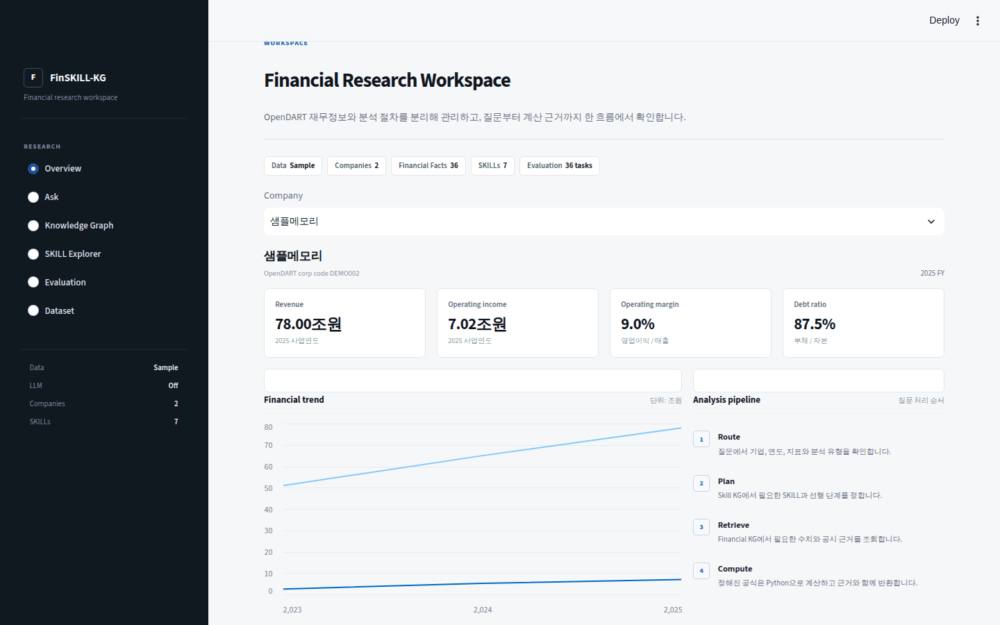
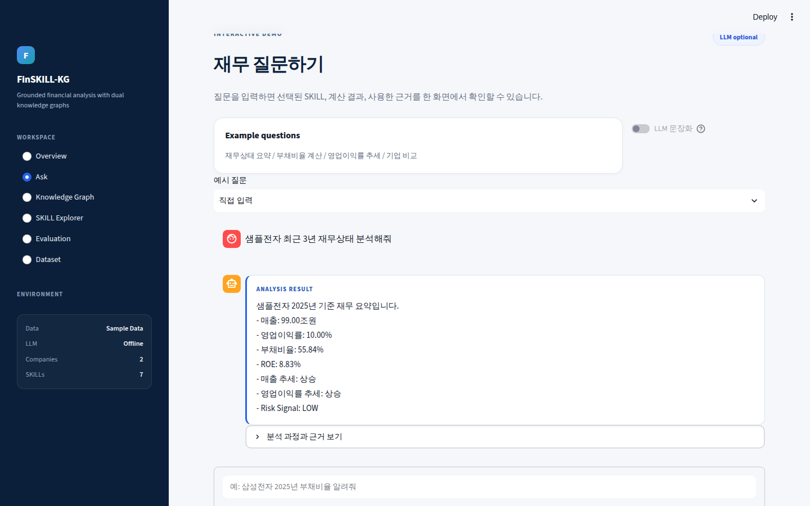
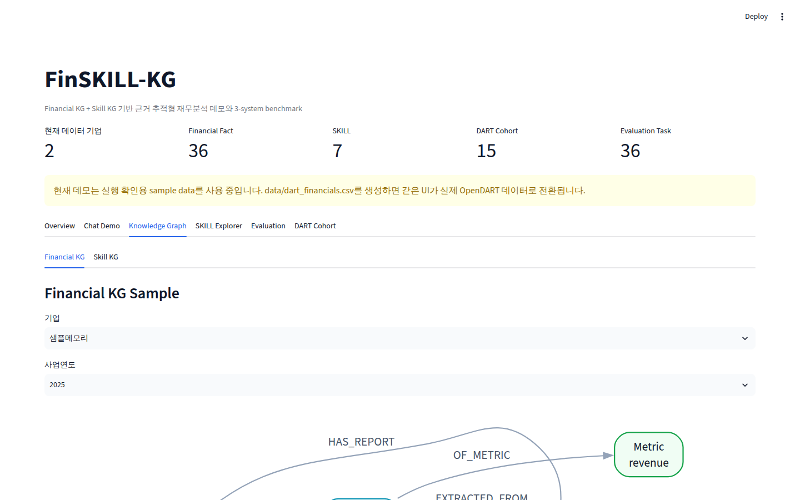
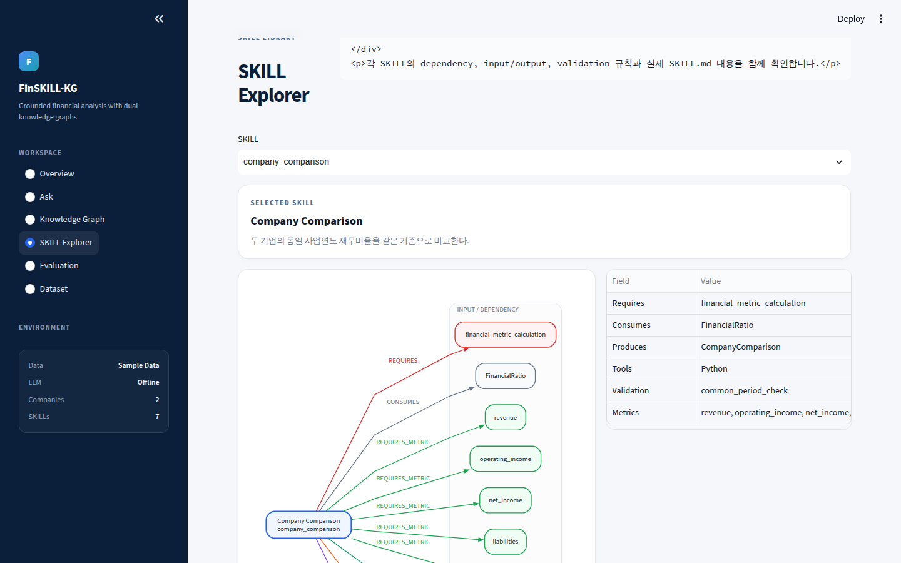
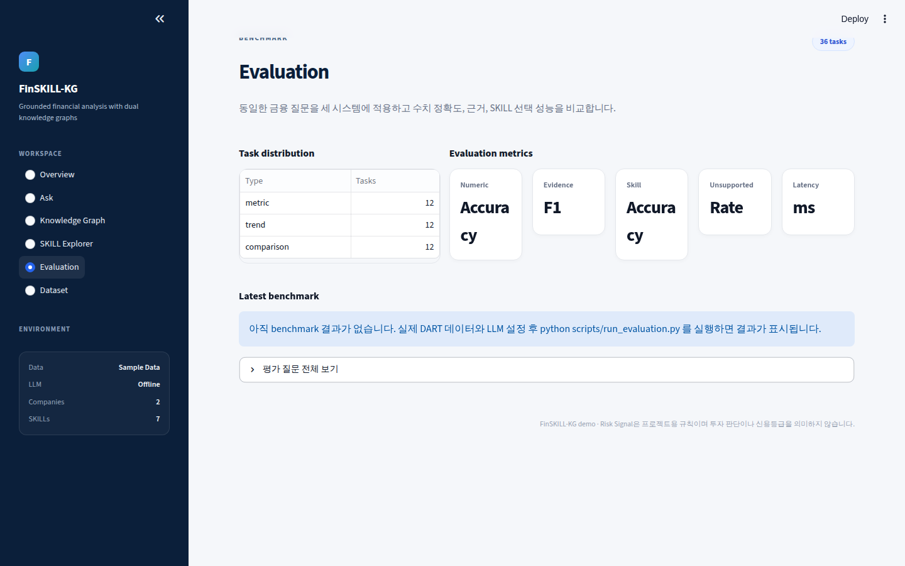
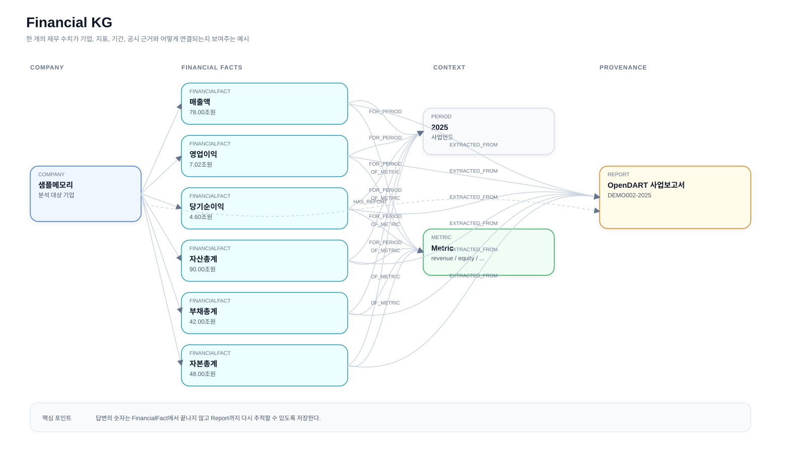
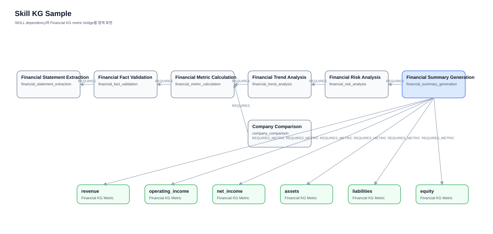
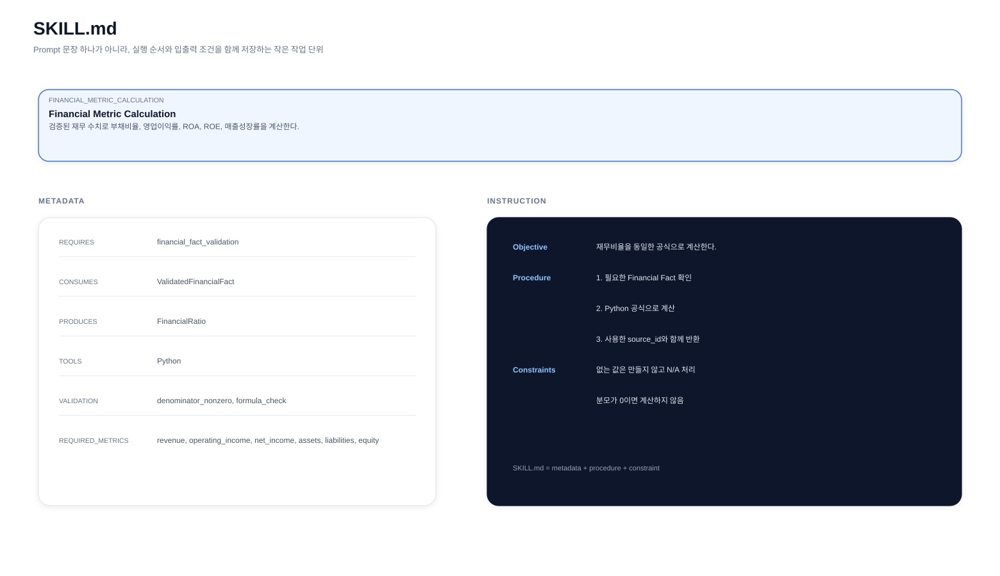

# FinSKILL-KG

OpenDART 재무 데이터를 Financial KG로 정리하고, 재무분석 절차를 SKILL로 나눠 질문에 필요한 단계만 실행하는 프로젝트입니다.

단순히 LLM에 재무제표를 넣고 답을 생성하는 방식보다, **숫자가 어디서 왔는지**, **어떤 계산을 거쳤는지**, **어떤 SKILL이 실행됐는지**를 끝까지 확인할 수 있게 만드는 데 초점을 뒀습니다.

현재 구현 범위는 다음과 같습니다.

- OpenDART 상장사 15개, 2023~2025년 사업보고서
- Financial KG + Skill KG
- 7개 `SKILL.md`
- 재무비율, 추세, Risk Signal 계산
- 사용자 질문 데모
- 36개 평가 질문
- `LLM Only`, `LLM + Financial KG`, `LLM + Skill KG + Financial KG` 비교
- Numerical Accuracy, Evidence F1, Skill Accuracy, Unsupported Rate, Latency 평가

> API Key는 저장소에 넣지 않습니다.  
> 실제 DART 데이터는 `scripts/fetch_dart_data.py`로 생성합니다.

---

## 왜 이렇게 만들었는가

재무 질문을 LLM에 바로 맡기면 답은 빠르게 나오지만, 숫자 계산과 출처 확인이 섞이기 시작하면 결과를 다시 검증하기가 어렵습니다. 특히 같은 질문도 표현에 따라 계산 방식이 달라지거나, 실제 공시에 없는 근거가 붙는 경우를 따로 확인해야 했습니다.

그래서 역할을 나눴습니다.

```text
Financial KG
→ 확인된 재무 수치와 출처를 저장

Skill KG
→ 어떤 분석을 먼저 해야 하는지 저장

Python
→ 공식이 정해진 계산을 담당

LLM
→ 필요한 경우 계산 결과를 문장으로 정리
```

이 구조가 실제로 도움이 되는지는 감으로 판단하지 않고, 같은 36개 질문을 세 조건으로 나눠 비교하도록 했습니다.

---

## Demo

현재 Streamlit 화면을 직접 실행해 캡처한 결과입니다. README 이미지는 별도 mockup이 아니라 실제 앱 화면입니다.



[원본 데모 영상](docs/assets/demo.webm)

| Chat Demo | Knowledge Graph |
| --- | --- |
|  |  |

| SKILL Explorer | Evaluation |
| --- | --- |
|  |  |

---

## 구조

이 프로젝트에서는 금융 지식과 분석 절차를 분리했습니다.

```text
Financial KG
= 재무 수치와 출처

Skill KG
= 어떤 업무를 어떤 순서로 수행하는지

SKILL.md
= 각 업무를 실제로 어떻게 수행할지
```

전체 흐름은 아래와 같습니다.

```text
OpenDART
   ↓
Financial Fact 정규화
   ↓
Financial KG
   ↑
   │ REQUIRES_METRIC
   │
Skill Router → Skill KG → SKILL.md
   ↓
Python 계산
   ↓
Evidence 기반 결과
   ↓
선택적으로 LLM 문장화
```

재무비율처럼 공식이 정해진 계산은 LLM에 맡기지 않고 Python으로 처리합니다. LLM은 baseline 실험에서는 직접 답을 생성하고, full system에서는 계산이 끝난 결과를 정리하는 용도로만 사용합니다.

---

## Financial KG

Financial KG에는 회사, 재무 수치, 지표, 사업연도, 공시 출처를 저장합니다.

```text
Company
  ├── HAS_REPORT ─────────────> Report
  └── HAS_FINANCIAL_FACT ─────> FinancialFact
                                  ├── OF_METRIC ───────> Metric
                                  ├── FOR_PERIOD ──────> Period
                                  └── EXTRACTED_FROM ──> Report
```

README에서 구조가 바로 보이도록 sample data로 일부를 시각화했습니다.



한 개의 Financial Fact에는 값만 저장하지 않습니다.

```text
company
year
metric
value
unit
source_id
source_url
```

예를 들어 부채비율 답변에 사용된 자본과 부채 값이 어느 사업보고서에서 왔는지 다시 따라갈 수 있습니다.

현재 정규화하는 기본 재무 항목은 6개입니다.

| metric | 의미 |
| --- | --- |
| `revenue` | 매출 |
| `operating_income` | 영업이익 |
| `net_income` | 당기순이익 |
| `assets` | 자산 |
| `liabilities` | 부채 |
| `equity` | 자본 |

---

## Skill KG

Skill KG는 데이터를 저장하는 그래프가 아니라 분석 절차를 저장하는 그래프입니다.

```text
Skill
  ├── REQUIRES ─────────> Skill
  ├── CONSUMES ─────────> DataType
  ├── PRODUCES ─────────> OutputType
  ├── USES_TOOL ────────> Tool
  ├── VALIDATED_BY ─────> ValidationRule
  └── REQUIRES_METRIC ──> Metric
```

`REQUIRES_METRIC` 관계가 Skill KG와 Financial KG를 연결합니다.



예를 들어 전체 재무 요약은 바로 생성하지 않습니다.

```text
financial_statement_extraction
        ↓
financial_fact_validation
        ↓
financial_metric_calculation
        ↓
financial_trend_analysis
        ↓
financial_risk_analysis
        ↓
financial_summary_generation
```

현재 사용 중인 SKILL은 7개입니다.

| SKILL | 역할 |
| --- | --- |
| `financial_statement_extraction` | 핵심 Financial Fact 정리 |
| `financial_fact_validation` | 중복, 출처, 회계식 확인 |
| `financial_metric_calculation` | 재무비율 계산 |
| `financial_trend_analysis` | 연도별 변화 확인 |
| `financial_risk_analysis` | 단순 Risk Signal 계산 |
| `company_comparison` | 동일 연도 기준 기업 비교 |
| `financial_summary_generation` | 계산 결과와 근거를 묶어 요약 |

---

## SKILL.md

SKILL은 프롬프트 한 줄이 아니라 작은 작업 단위로 만들었습니다.



각 파일은 크게 두 부분으로 나뉩니다.

```text
Metadata
- requires
- consumes
- produces
- tools
- validation
- required_metrics

Instruction
- Objective
- Procedure
- Constraints
```

예를 들어 `financial_metric_calculation`은 어떤 재무 항목이 필요한지와 계산 공식, 누락값 처리 방법을 같이 갖습니다.

이 구조를 사용하면 Skill KG는 metadata로 만들고, 실제 실행 시에는 같은 파일의 Procedure와 Constraints를 사용할 수 있습니다.

---

## 재무 계산

계산식은 `src/finskillkg/metrics.py`에 고정했습니다.

```text
부채비율   = 부채 / 자본 × 100
영업이익률 = 영업이익 / 매출 × 100
ROA        = 당기순이익 / 자산 × 100
ROE        = 당기순이익 / 자본 × 100
매출성장률 = (당기매출 - 전기매출) / 전기매출 × 100
```

필요한 값이 없거나 분모가 0이면 임의의 값을 만들지 않고 `N/A`로 처리합니다.

Risk Signal도 같은 방식으로 Python 규칙으로 계산합니다. 이 값은 프로젝트 흐름을 확인하기 위한 단순 지표이며 투자등급이나 신용등급을 의미하지 않습니다.

---

## 질문 처리

사용자는 Streamlit의 Chat Demo에서 바로 질문할 수 있습니다.

예시:

```text
삼성전자 2025년 부채비율 알려줘
SK하이닉스 2023~2025년 매출 추세 알려줘
현대자동차와 기아 ROE 비교해줘
삼성전자 최근 재무상태 요약해줘
```

질문이 들어오면 다음 순서로 처리합니다.

```text
질문
 ↓
기업 / 연도 / metric / intent 확인
 ↓
target SKILL 선택
 ↓
dependency plan 생성
 ↓
Financial KG 조회
 ↓
Python 계산
 ↓
answer + values + evidence 반환
```

답변 화면에서는 최종 문장뿐 아니라 실제 실행된 SKILL 순서와 사용한 `source_id`도 같이 확인할 수 있습니다.

---

## OpenDART 데이터

평가 대상 기업은 `config/dart_companies.yaml`에 고정했습니다.

| 기업 | 종목코드 | 업종 |
| --- | ---: | --- |
| 삼성전자 | 005930 | 반도체/전자 |
| SK하이닉스 | 000660 | 반도체 |
| 현대자동차 | 005380 | 자동차 |
| 기아 | 000270 | 자동차 |
| 현대모비스 | 012330 | 자동차부품 |
| NAVER | 035420 | 인터넷/플랫폼 |
| 카카오 | 035720 | 인터넷/플랫폼 |
| LG전자 | 066570 | 전자 |
| LG에너지솔루션 | 373220 | 이차전지 |
| 삼성SDI | 006400 | 이차전지 |
| POSCO홀딩스 | 005490 | 철강/소재 |
| 셀트리온 | 068270 | 바이오 |
| 삼성바이오로직스 | 207940 | 바이오 |
| SK텔레콤 | 017670 | 통신 |
| KT | 030200 | 통신 |

기본 분석 연도는 2023~2025년입니다.

데이터 수집은 OpenDART `fnlttSinglAcntAll`을 사용합니다.

```bash
export DART_API_KEY="YOUR_KEY"
python scripts/fetch_dart_data.py
```

수집 과정은 다음과 같습니다.

```text
기업명
 ↓
OpenDART corp code 조회
 ↓
CFS 연결재무제표 우선 조회
 ↓
없으면 OFS 사용
 ↓
계정명 정규화
 ↓
data/dart_financials.csv
```

정상적으로 끝나면 아래 파일이 생성됩니다.

```text
data/
├── dart_financials.csv
└── dart_financials.manifest.json
```

manifest에는 실제 corp code, 사업연도, CFS/OFS 구분, 수집된 metric, DART 접수번호를 남깁니다.

---

## 평가

비교 대상은 세 가지입니다.

| System | Financial KG | Skill KG | 계산 |
| --- | :---: | :---: | --- |
| `llm_only` | X | X | LLM |
| `llm_financial_kg` | O | X | LLM |
| `llm_skill_financial_kg` | O | O | Python + LLM rendering |

평가 질문은 총 36개입니다.

| 유형 | 문항 수 | 예시 |
| --- | ---: | --- |
| metric | 12 | 삼성전자의 2025년 부채비율은 몇 %인가? |
| trend | 12 | SK하이닉스의 2023~2025년 매출 추세는? |
| comparison | 12 | 현대자동차와 기아의 ROE를 비교해줘 |

정답 숫자를 JSONL에 직접 적어두지 않았습니다. 실행 시 Financial KG의 값과 동일한 Python 공식으로 ground truth를 계산합니다.

평가 지표는 다음 다섯 가지입니다.

| 지표 | 확인하는 내용 |
| --- | --- |
| Numerical Accuracy | 계산값이 정답 허용 오차 안에 있는지 |
| Evidence F1 | 실제 사용한 DART 출처를 맞게 제시했는지 |
| Skill Accuracy | 질문에 맞는 target SKILL을 선택했는지 |
| Unsupported Rate | 근거에 없는 수치나 source를 추가했는지 |
| Latency | 질문 하나를 처리하는 데 걸린 시간 |

실행:

```bash
export LLM_API_URL="YOUR_CHAT_COMPLETIONS_ENDPOINT"
export LLM_API_KEY="YOUR_KEY"
export LLM_MODEL="YOUR_MODEL"

python scripts/run_evaluation.py
```

결과는 아래에 저장됩니다.

```text
outputs/evaluation/
├── results.jsonl
└── summary.csv
```

LLM 설정 없이 full system만 먼저 확인할 수도 있습니다.

```bash
python scripts/run_evaluation.py --systems llm_skill_financial_kg
```

---

## EduBridge에서 학습

EduBridge에서는 Skill Router를 직접 학습하도록 별도 실행 파일을 뒀습니다.

설치:

```bash
pip install -r edubridge/requirements.txt
```

학습:

```bash
python edubridge/train.py --epochs 20
```

기본 학습 데이터는 5개 target SKILL을 균형 있게 구성해 총 14,000개 질문을 사용합니다.

```text
Train  10,000
Valid   2,000
Test    2,000
```

학습 결과는 `edubridge/artifacts/`에 저장됩니다.

```text
skill_router.joblib
metrics.json
history.csv
confusion_matrix.csv
dataset/
```

학습된 Router를 실제 KG 분석 흐름에 연결하려면:

```bash
python edubridge/inference.py \
  --question "샘플전자 2025년 부채비율 알려줘"
```

Financial KG와 Skill KG 자체는 학습 대상이 아니라 데이터와 업무 구조를 표현하는 그래프입니다. EduBridge에서 학습하는 부분은 사용자 질문을 5개 target SKILL 중 하나로 분류하는 Router입니다.

기존 `edubridge/main.py`는 외부 의존성 없이 흐름만 확인하는 보조 실행 파일로 남겨두었습니다.

자세한 학습 방법은 [edubridge/README.md](edubridge/README.md)에 정리했습니다.

---

## 실행

Python 3.11 기준입니다.

```bash
git clone https://github.com/yunjinyong730/FinSKILL-KG.git
cd FinSKILL-KG

python -m venv .venv
```

Windows:

```powershell
.venv\Scripts\activate
```

Linux / macOS:

```bash
source .venv/bin/activate
```

설치:

```bash
pip install -r requirements.txt
```

기본 KG 생성:

```bash
python run_pipeline.py
```

데모 실행:

```bash
streamlit run app.py
```

`data/dart_financials.csv`가 있으면 실제 DART 데이터를 사용하고, 없으면 `data/sample_financials.csv`로 실행됩니다.

LLM을 사용하지 않아도 KG 조회, SKILL routing, 재무 계산은 동작합니다.

---

## Demo Site

Streamlit 화면은 아래 6개 영역으로 구성했습니다.

```text
Overview
Chat Demo
Knowledge Graph
SKILL Explorer
Evaluation
DART Cohort
```

`Knowledge Graph`에서는 기업과 연도를 바꿔가며 Financial KG를 확인할 수 있고, Skill KG에서는 중심 SKILL을 선택해 dependency와 metric bridge를 볼 수 있습니다.

`SKILL Explorer`에서는 metadata와 실제 `SKILL.md` 본문을 같이 보여줍니다.

Docker로도 실행할 수 있습니다.

```bash
docker build -t finskill-kg .
docker run --rm -p 8501:8501 finskill-kg
```

배포 관련 내용은 [docs/DEPLOYMENT.md](docs/DEPLOYMENT.md)에 따로 정리했습니다.

---

## Neo4j

기본 실행은 NetworkX로 동작합니다. 필요하면 생성된 Dual KG를 Neo4j로 옮길 수 있습니다.

```bash
export NEO4J_URI="bolt://localhost:7687"
export NEO4J_USER="neo4j"
export NEO4J_PASSWORD="YOUR_PASSWORD"

python scripts/export_neo4j.py --graph outputs/dual_kg.json --clear
```

현재 분석 엔진 자체는 NetworkX를 사용하고, Neo4j는 그래프 저장과 시각화 용도로 사용합니다.

---

## Repository

```text
.
├── app.py
├── Dockerfile
├── run_pipeline.py
├── config/
│   ├── dart_companies.yaml
│   └── evaluation.yaml
├── data/
│   ├── sample_financials.csv
│   └── evaluation_questions.jsonl
├── docs/
│   ├── DEPLOYMENT.md
│   └── assets/
├── scripts/
│   ├── fetch_dart_data.py
│   ├── run_evaluation.py
│   ├── export_neo4j.py
│   ├── generate_readme_graphs.py
│   └── capture_readme_media.py
├── skills/
│   └── */SKILL.md
├── src/finskillkg/
│   ├── dart.py
│   ├── normalize.py
│   ├── metrics.py
│   ├── skills.py
│   ├── graph.py
│   ├── router.py
│   ├── engine.py
│   ├── evaluation.py
│   ├── visualize.py
│   └── ...
└── tests/
```

테스트:

```bash
python -m pytest -q
```

README의 SVG, 화면 캡처, GIF도 코드로 다시 만들 수 있습니다.

```bash
pip install -r requirements.txt -r requirements-dev.txt
python -m playwright install chromium
python scripts/generate_readme_graphs.py
python scripts/capture_readme_media.py
```

---
